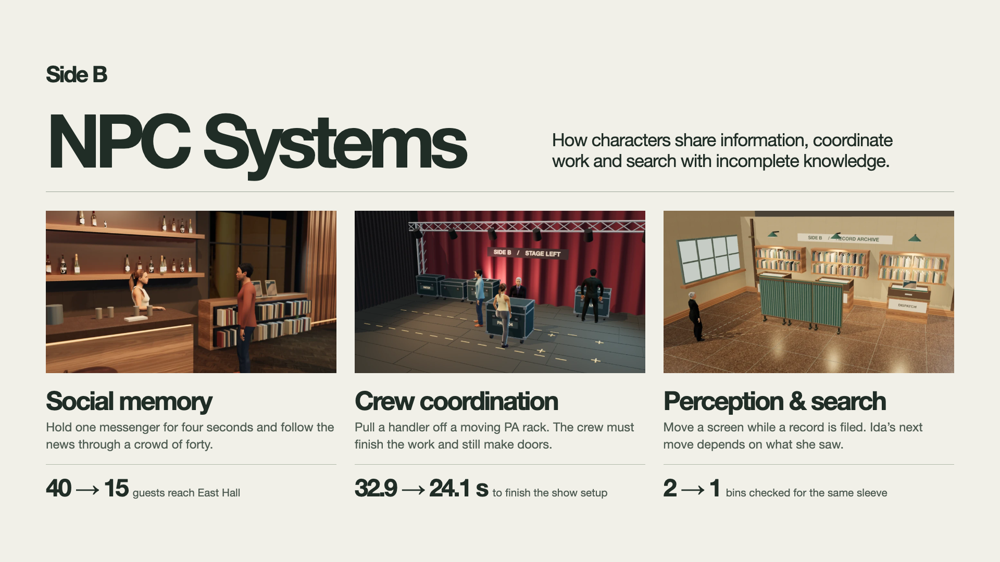

# Side B · NPC Systems

Three playable NPC systems share a music venue. Guests pass on a last-minute venue change, a stage crew recovers from an interruption, and an archivist searches for a record she may never have seen being filed.

[Play the suite](https://ayyycn.github.io/side-b-npc-demo/) · [Download the pitch film](https://github.com/AyyyCn/side-b-npc-demo/releases/download/v3.0.0/npc-systems.mp4) · [Download the 16:9 slide](https://github.com/AyyyCn/side-b-npc-demo/releases/download/v3.0.0/npc-systems.png) · [Download the offline demo](https://github.com/AyyyCn/side-b-npc-demo/releases/download/v3.0.0/npc-systems.html)



| System | Try this | Result in the featured scenario |
| --- | --- | --- |
| [Social memory](https://ayyycn.github.io/side-b-npc-demo/?crowd) | Hold Esme for four seconds. Ask Finn how he heard about the show in each replay. | East Hall receives 40 guests in the original and 15 after the hold. |
| [Crew coordination](https://ayyycn.github.io/side-b-npc-demo/?crew) | Radio Wes while he and Esme are halfway through moving the PA rack. | Keeping each original team finishes at 32.9 s. Nina relieves Wes and the replanned crew finishes at 24.1 s, ahead of the 26.0 s door time. |
| [Perception and search](https://ayyycn.github.io/side-b-npc-demo/?perception) | File the sleeve in Dispatch. Replay with the screen across the archive, then fold it aside. | With the screen across, Ida checks Catalogue, finds it empty and searches Dispatch. With a clear view she goes straight to Dispatch. |

The listening room and the forty-person crowd replay are two views of social memory. The six-person room lets you start an invitation, then question individual guests about its source. [Play the listening room](https://ayyycn.github.io/side-b-npc-demo/?room)

## Connect the experiments

- In the crowd replay, choose **Plan for this crowd**. The stage planner reruns that seed and interruption to obtain the East Hall attendance. The 15-person work order needs one speaker zone. A second zone is required at 24 guests.
- In the archive, choose **Outcome**, then **Send the sleeve to sound check**. The audio check must wait until Ida actually finds the reference sleeve. For the 40-person setup, an unobstructed deposit makes the original crew ready at 22.7 s. The obstructed deposit moves that to 25.0 s. The stage view links back to both source experiments.

## How it works

**Social memory.** The crowd advances in 100 ms steps. A spatial grid finds nearby guests. Knowledge travels through completed, unobstructed exchanges and each guest walks toward the hall they believe is correct. A worker restores the complete world at 6.7 s, tries each of 40 possible four-second holds, and ranks the resulting hall changes. Select a guest or replay a receipt to inspect exactly what they knew at any frame. Crowd 746 is the featured example. In crowd 722, interrupting Inez increases East Hall attendance from 25 to 40. [Simulation](comparison/simulation.js) · [Counterfactual worker](comparison/worker.js)

**Crew coordination.** A branch-and-bound scheduler searches eligible assignments and job orderings for the earliest opening cue on this small work order. It accounts for skills, distinct partners, travel to the right rack handle or station, external release times and prerequisite jobs. At a radio call the case stays where it is. Unaffected jobs continue, finished work is retained and the solver restarts from the crew’s live positions. The fixed-team comparison runs the same solver with the original team for each job. The default scenario has four crew members and six jobs. [Planner](crew/planner.js) · [Jobs and skills](crew/scenario.js)

**Perception and search.** Ida’s filing observation uses her field of view, range and the footprint of the physical screen. A missed deposit eliminates only the bins she could see. Search uses posterior probabilities from 50 sample filings and a finite-horizon policy that compares the expected walking and inspection time for each visit order. A* supplies traversable paths around the partition. Each inspection produces new evidence. The policy has access to the observations and geometry. The hidden bin is held by the world simulation. [Observation model and search](perception/search.js)

The demo uses skinned human characters and animated 3D environments. Paired crowds share baked skeleton animations through a GPU texture. Close-up crew and archive scenes use the original character rigs with two-bone hand placement. The pitch film uses edited gameplay, and the overview uses frames captured from the three scenes. [Crowd rendering](comparison/cast.js) · [Close-up rendering](npc/studio.js)

## Run locally

Use Node.js 20 or newer and a WebGL 2 browser.

```sh
npm ci
npm run build
npm start
```

Open the [local suite](http://127.0.0.1:19447/). The build also creates a self-contained `play.html` that opens directly from disk. Query routes include `?home`, `?crowd`, `?room`, `?crew` and `?perception`. The overview slide is at `?deck`. The original crowd and listening-room pitch cuts remain available at `?pitch` and `?screening`.

The hosted site uses a split build so opening the gallery only loads the suite logic and previews. Run `npm run build:site` to produce the static `site/` directory.

The three simulations run deterministically offline. An optional local llama.cpp server interprets free-text questions about a guest. The simulation supplies each answer from that person’s own evidence. The tested local model is Qwen2.5-1.5B-Instruct Q4_K_M.

```sh
llama-server -m /path/to/model.gguf --host 127.0.0.1 --port 19442 -c 1024
```

With the model running, start the application server with `MODEL_URL=http://127.0.0.1:19442 npm start`.

## Verify

With the built application running, install Playwright Chromium and run the suite. Set `BROWSER_CHANNEL=chrome` to use an installed desktop Chrome or `DEMO_URL` to test another deployment.

```sh
npx playwright install chromium
npm test
```

The tests cover identical pre-interruption histories, causal receipts, both social-memory views, schedule feasibility and handoffs, physical continuity, a hidden-location information leak regression, search probabilities and unobstructed walking paths. The browser check exercises all three through their normal controls and passes the crowd and archive results into the stage plan.

## Art and software credits

The four character rigs and their movement clips come from Innerscene’s CC0 locomotion collection, adapted from MakeHuman. The demo optimizes the meshes and textures and adds clothing colors, poses and props. [Harper](https://www.innerscene.com/tools/library/3d-parts/locomotion-collection-harper-3d-person-animated-797e1e2a) · [Maya](https://www.innerscene.com/tools/library/3d-parts/locomotion-collection-maya-3d-person-animated-1499b2fd) · [Sam](https://www.innerscene.com/tools/library/3d-parts/locomotion-collection-sam-3d-person-animated-dc23800f) · [Jordan](https://www.innerscene.com/tools/library/3d-parts/locomotion-collection-jordan-3d-person-animated-911f1584)

Poly Haven provides the CC0 furniture, bottles, plant, surfaces and night panorama. [Lounge chair](https://polyhaven.com/a/mid_century_lounge_chair) · [Bar stool](https://polyhaven.com/a/bar_chair_round_01) · [Bottles](https://polyhaven.com/a/wine_bottles_01) · [Plant](https://polyhaven.com/a/potted_plant_04) · [Walnut](https://polyhaven.com/a/smoked_walnut_veneer) · [Terrazzo](https://polyhaven.com/a/terrazzo_tiles) · [Parquet](https://polyhaven.com/a/herringbone_parquet) · [Plaster](https://polyhaven.com/a/plastered_wall_02) · [Street at night](https://polyhaven.com/a/cobblestone_street_night) · [Asset license](https://polyhaven.com/license)

The browser build includes Three.js, its bundled Earcut triangulator and the meshoptimizer decoder. [Third-party software notices](THIRD_PARTY_NOTICES.txt)
