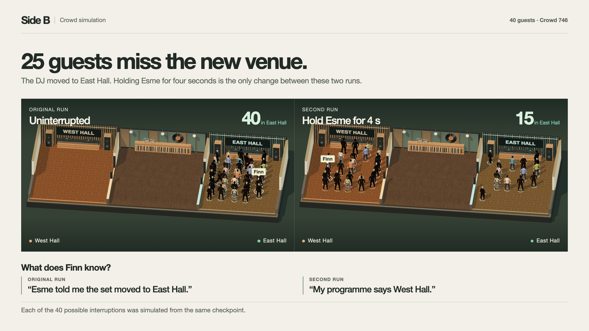

# Side B

Stop one messenger for four seconds and see who ends up in the wrong hall. Side B runs two copies of the same 40-person crowd. Each guest walks to the venue they personally believe is correct. A second copy of the simulation lets you interrupt any guest and inspect the consequences.



[Download the 23-second pitch clip](https://github.com/AyyyCn/side-b-npc-demo/releases/download/v2.0.0/crowd-fork.mp4) · [Download the 16:9 slide](https://github.com/AyyyCn/side-b-npc-demo/releases/download/v2.0.0/crowd-slide.png) · [Download the standalone demo](https://github.com/AyyyCn/side-b-npc-demo/releases/download/v2.0.0/side-b.html)

The MP4 and PNG are 1920 × 1080 captures from the interactive application. The HTML runs offline in a WebGL 2 browser.

## Try the interruption

1. Open the demo and press **Replay**. The programme says West Hall. At 2.8 seconds the DJ radios one guest with a change to East Hall.
2. At the 6.7-second checkpoint the runs split. In crowd 746, Lark has just told Esme about East Hall. In the original run Esme tells Finn at 7.5 seconds. The four-second hold prevents that exchange in the second run.
3. Select **Outcome**. At 40 seconds the attendance at East Hall is 40 in the original and 15 in the second run. Inspect Finn, open **Trace the evidence**, and select a timestamp to replay that moment.
4. Choose another guest under **Interrupt**, or select **New crowd**. The browser computes all 40 possible interruptions for each crowd. **Largest effect** selects the guest whose hold changed the most final hall assignments.

Crowd 746 was selected to make the effect visible in a pitch. Placement, radio recipient, social preferences, walking speeds, and departure times depend on the seed. A hold can reduce attendance, increase it, or leave it unchanged. In crowd 722, holding Inez increases attendance at East Hall from 25 to 40.

## Run from source

Use Node.js 20 or newer.

```sh
npm ci
npm run build
npm start
```

- [Open the interactive comparison](http://127.0.0.1:19447/).
- [Open the guided pitch capture](http://127.0.0.1:19447/?pitch) or [open the still used for the slide](http://127.0.0.1:19447/?slide).
- [Try crowd 722](http://127.0.0.1:19447/?seed=722). The `seed` query parameter accepts an unsigned 32-bit integer.
- [Play the original six-person listening room](http://127.0.0.1:19447/?room) or [watch its guided cut](http://127.0.0.1:19447/?screening).

## What the simulation does

**Local knowledge.** The simulation advances in fixed 100 ms steps. Each guest reads the original programme. A newer venue reaches a guest through the radio or a completed face-to-face exchange. A spatial grid finds potential contacts. A speaker chooses someone using distance, familiarity, availability and their history of conversations. The two people must remain in range and have an unobstructed line through the floor plan. Each guest navigates toward their own destination, uses doorways and steers around neighbours. [Simulation and floor plan](comparison/simulation.js)

**Counterfactual replay.** A Web Worker saves the full state, including conversations in progress, at the fork. It restores that checkpoint for each possible four-second hold and ranks the outcomes by the number of guests physically in opposite halls at the end. Guests still in the foyer are excluded from that count. Counts over the two 3D views show arrivals at the current playhead. Rewinding also rewinds the guest interviews. [Branch analysis](comparison/worker.js)

**Evidence.** Every accepted venue change records its tick, speaker, listener, positions and the exact parent message. Following those links reconstructs what one guest heard. A missing conversation can change later encounters between other guests, so the full effect is measured by rerunning the world. [Evidence and replay controls](comparison/app.js)

**Rendering.** Both venues use the same camera. Four low-detail character rigs have their walk and idle clips sampled into bone-matrix textures. Per-instance animation rows and transforms render the two crowds independently, including when seeking backwards. [Instanced animation](comparison/cast.js) · [Paired renderer](comparison/view.js)

## Ask a guest in both runs

The evidence trail works offline. With a local llama.cpp server, **Trace the evidence** also accepts a typed question. The model interprets the question. The demo answers it separately in each run using only the selected guest’s evidence or position at the chosen time. The original listening room supports typed questions as well. The local configuration was tested with Qwen2.5-1.5B-Instruct Q4_K_M.

```sh
llama-server -m /path/to/model.gguf --host 127.0.0.1 --port 19442 -c 1024
```

Run the following in a second terminal from the built project.

```sh
MODEL_URL=http://127.0.0.1:19442 npm start
```

## Verify the demo

With the demo server running, install Playwright Chromium and run the tests. Set `BROWSER_CHANNEL=chrome` to use an installed desktop Chrome.

```sh
npx playwright install chromium
npm test
```

The simulation tests check bit-for-bit replay, identical pre-interruption states, the physical conditions of every transmission, and final attendance against the recorded positions. The browser check also exercises the timeline, guest inspection, alternative interventions, different seeds and both routes through the original listening room.

## Art and software credits

The four character rigs and their movement clips come from Innerscene’s CC0 locomotion collection, adapted from MakeHuman. The demo optimizes the meshes and textures and adds clothing colors, poses and props. [Harper](https://www.innerscene.com/tools/library/3d-parts/locomotion-collection-harper-3d-person-animated-797e1e2a) · [Maya](https://www.innerscene.com/tools/library/3d-parts/locomotion-collection-maya-3d-person-animated-1499b2fd) · [Sam](https://www.innerscene.com/tools/library/3d-parts/locomotion-collection-sam-3d-person-animated-dc23800f) · [Jordan](https://www.innerscene.com/tools/library/3d-parts/locomotion-collection-jordan-3d-person-animated-911f1584)

Poly Haven provides the CC0 furniture, bottles, plant, surfaces and night panorama. [Lounge chair](https://polyhaven.com/a/mid_century_lounge_chair) · [Bar stool](https://polyhaven.com/a/bar_chair_round_01) · [Bottles](https://polyhaven.com/a/wine_bottles_01) · [Plant](https://polyhaven.com/a/potted_plant_04) · [Walnut](https://polyhaven.com/a/smoked_walnut_veneer) · [Terrazzo](https://polyhaven.com/a/terrazzo_tiles) · [Parquet](https://polyhaven.com/a/herringbone_parquet) · [Plaster](https://polyhaven.com/a/plastered_wall_02) · [Street at night](https://polyhaven.com/a/cobblestone_street_night) · [Asset license](https://polyhaven.com/license)

The browser build includes Three.js, its bundled Earcut triangulator and the meshoptimizer decoder. [Third-party software notices](THIRD_PARTY_NOTICES.txt)
