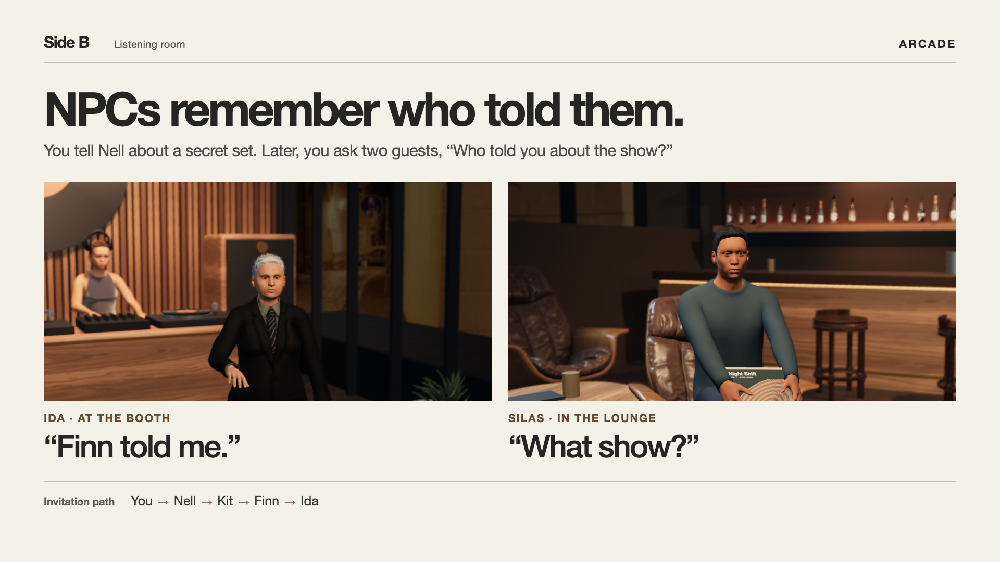

# Side B

One invitation changes the audience for a secret DJ set. Tell Nell and she passes the news to Kit, who tells Finn, who finds Ida. Tell Silas and he keeps it to himself. Select a guest and ask who told them.



[Download the 20-second pitch clip](https://github.com/AyyyCn/side-b-npc-demo/releases/download/v1.0.0/side-b-demo.mp4) · [Download the slide](https://github.com/AyyyCn/side-b-npc-demo/releases/download/v1.0.0/side-b-slide.png) · [Download the playable HTML](https://github.com/AyyyCn/side-b-npc-demo/releases/download/v1.0.0/side-b.html)

The clip and slide are 1920 × 1080. The footage follows the interactive demo’s Nell route and includes on-screen dialogue. Open the downloaded HTML in a WebGL 2 browser to play it offline.

## Run from source

Use Node.js 20 or newer.

```sh
npm ci
npm run build
npm start
```

[Play the listening room locally](http://127.0.0.1:19447/) or [open the guided screening](http://127.0.0.1:19447/?screening). In the screening, press **Play demo** to watch the invitation travel and hear the original score. The interactive view lets you choose the first guest, interview anyone, switch cameras, mute the music, and restart. Press **F** for fullscreen.

## How guests remember

The room advances at 15 simulation ticks per second. An informed guest approaches a friend, pauses for the exchange, and stores their name as the friend's direct source. Those invitations determine who walks to the booth. When you ask a guest who told them, the room reads that guest’s memory from the current run. Restart clears those memories. [Room simulation](room.js)

Six characters share four skinned rigs with walk, idle, and seated animation. Head turns and arm poses respond to each exchange. The camera follows the current speaker, and the electric-piano score plays through Web Audio. [Character animation](cast.js) · [Camera and lighting](stage.js) · [Score](sound.js)

## Ask in your own words

The three preset questions work offline. To type a question, start a local llama.cpp server with a chat model, then start the demo server with its address. This release was tested with Qwen2.5-1.5B-Instruct Q4_K_M.

```sh
llama-server -m /path/to/model.gguf --host 127.0.0.1 --port 19442 -c 1024
```

Run the following command in a second terminal from the built project.

```sh
MODEL_URL=http://127.0.0.1:19442 npm start
```

The model classifies the question as asking about the source, venue, occupation, or another topic. The room chooses the reply from the character’s memory and authored dialogue. The local server binds to the loopback interface. [Question handler](serve.mjs)

## Verify the demo

With the demo server running, install Playwright’s Chromium and run the browser check. It plays both invitation routes, interviews guests and checks that restarting clears the room. To use an installed desktop Chrome, set `BROWSER_CHANNEL=chrome`.

```sh
npx playwright install chromium
npm test
```

## Art and software credits

The four character rigs and their movement clips come from Innerscene’s CC0 locomotion collection, adapted from MakeHuman. The demo optimizes the meshes and textures and adds clothing colors, poses and props. [Harper](https://www.innerscene.com/tools/library/3d-parts/locomotion-collection-harper-3d-person-animated-797e1e2a) · [Maya](https://www.innerscene.com/tools/library/3d-parts/locomotion-collection-maya-3d-person-animated-1499b2fd) · [Sam](https://www.innerscene.com/tools/library/3d-parts/locomotion-collection-sam-3d-person-animated-dc23800f) · [Jordan](https://www.innerscene.com/tools/library/3d-parts/locomotion-collection-jordan-3d-person-animated-911f1584)

Poly Haven provides the CC0 furniture, bottles, plant, surfaces and night panorama. [Lounge chair](https://polyhaven.com/a/mid_century_lounge_chair) · [Bar stool](https://polyhaven.com/a/bar_chair_round_01) · [Bottles](https://polyhaven.com/a/wine_bottles_01) · [Plant](https://polyhaven.com/a/potted_plant_04) · [Walnut](https://polyhaven.com/a/smoked_walnut_veneer) · [Terrazzo](https://polyhaven.com/a/terrazzo_tiles) · [Parquet](https://polyhaven.com/a/herringbone_parquet) · [Plaster](https://polyhaven.com/a/plastered_wall_02) · [Street at night](https://polyhaven.com/a/cobblestone_street_night) · [Asset license](https://polyhaven.com/license)

The browser build includes Three.js, its bundled Earcut triangulator and the meshoptimizer decoder. [Third-party software notices](THIRD_PARTY_NOTICES.txt)
